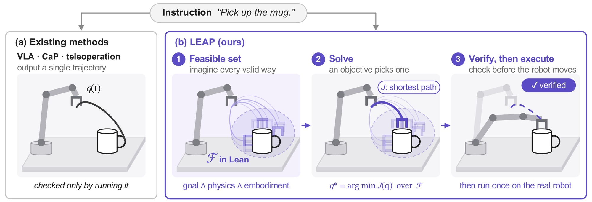
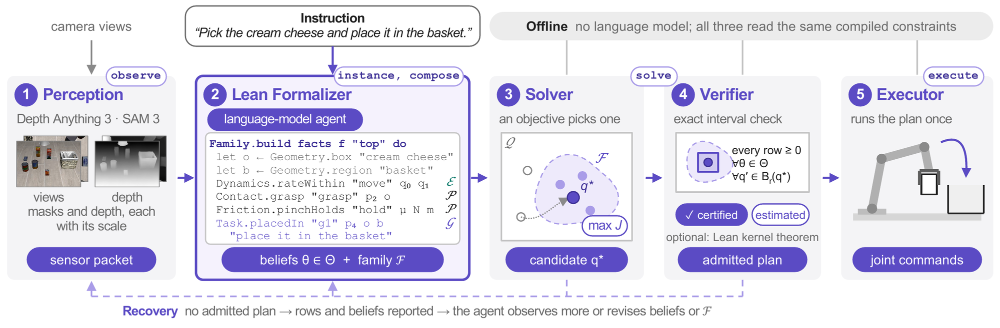
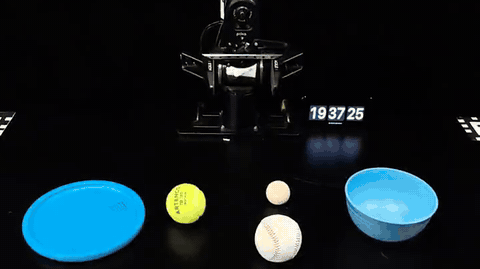
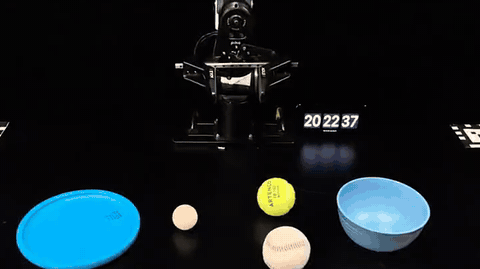
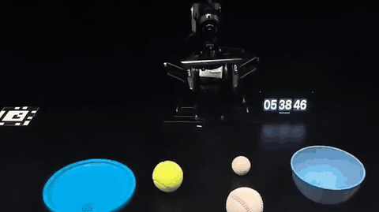
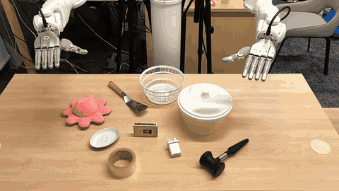
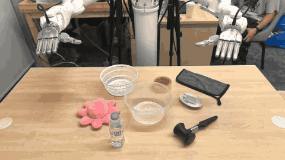

<h2 align="center">LEAP: Lean as Policy for Verifiable Robot Control</h2>

<p align="center">
  <a href="https://weichenfan.github.io/Weichen/">Weichen Fan</a><sup>1</sup>, <a href="https://kairuihu.github.io/">Kairui Hu</a><sup>1</sup>, <a href="https://paranioar.github.io/">Haiwen Diao</a><sup>1</sup>, <a href="https://sy-h.com/">Siyuan Hu</a><sup>1</sup>,<br>
  Ziyi Wang<sup>1</sup>, <a href="https://ziqihuangg.github.io/">Ziqi Huang</a><sup>1</sup>, <a href="https://liuziwei7.github.io/">Ziwei Liu</a><sup>1,†</sup>
</p>
<p align="center">
  <sup>1</sup>S-Lab, Nanyang Technological University<br>
  <sub>† Corresponding author</sub>
</p>

<p align="center">
  <b>📄 Paper</b> (arXiv, coming soon) ·
  <a href="https://lean-as-policy.github.io/"><b>Project Page</b></a> ·
  <a href="https://lean-as-policy.github.io/#video"><b>Video</b></a>
</p>
<p align="center">
  <a href="https://lean-as-policy.github.io/"></a>
  <a href="https://lean-lang.org/"></a>
  
</p>

This is the official repository of **LEAP**. The code will be released here; until then, the
[project page](https://lean-as-policy.github.io/) has the overview video, the real-robot rollouts and
an interactive walk-through of the pipeline.

<p align="center">
  
</p>

## Overview

**LEAP defines all valid actions, picks one, and verifies it before the robot moves.** Vision-language-action
models, code-as-policy agents and human teleoperators each produce a single trajectory, and whether it was right is
found only by running it. LEAP reverses the order. A language-model agent writes the *feasible set* of a
manipulation task as a short Lean 4 program over a library of physical laws; a solver picks the best action from
that set; and a checker verifies the action against the same specification for every scene that perception
allows, before the action is executed once.

- **Actions as a set, not a guess.** Goal, physics and embodiment constraints describe every valid way to do the
  task, such as a rim, handle or side grasp of a mug, without committing to one.
- **Checked before execution.** A candidate from any source, whether the solver, another policy or a recorded
  demonstration, can be judged against the specification before the robot moves.
- **Uncertainty kept explicit.** Perception becomes interval beliefs; a plan is certified when it holds over all
  of them, or estimated with a stated confidence otherwise.
- **One law library for every robot.** Laws are small Lean functions with soundness theorems, shared across
  robots and benchmarks; a new robot needs a profile, not new laws.

## Method

<p align="center">
  
</p>

**LEAP-Harness** has five modules. *Perception* (Depth Anything 3 and SAM 3) turns camera views into masks and
depth with their scale. The *Lean Formalizer*, the only module that uses a language model, states the beliefs and
writes the action family. The *Solver*, *Verifier* and *Executor* run offline on the same compiled constraints:
the solver searches the family for the action that best meets the objective, the verifier checks it over every
scene the beliefs allow, and the executor runs the admitted plan once as joint commands. When no plan is
admitted, the reasons are reported back and the agent observes more or revises its beliefs.

### Real-robot tasks

| Baseball | Golf ball | Tennis ball |
|:---:|:---:|:---:|
| [](https://lean-as-policy.github.io/) | [](https://lean-as-policy.github.io/) | [](https://lean-as-policy.github.io/) |
| *Put the ball in the bowl, then the bowl on the plate.* | | |

Side-by-side rollouts against GPT-6 Astra acting directly are on the [project page](https://lean-as-policy.github.io/#real-world).

### Marvin humanoid arms

| Lid, card box, container | Basket and bowl |
|:---:|:---:|
| [](https://lean-as-policy.github.io/#marvin) | [](https://lean-as-policy.github.io/#marvin) |
| *Put the card box into the closed container.* | *Charger plug into the basket, plush toy into the bowl.* |

The same library drives a TianJi Marvin humanoid with two arms and multi-finger hands. In the first task both hands
work together: one hand lifts the lid and holds it clear, the other puts the card box inside, and the hand holding the
lid closes the container again. In the second, each hand places one object. Every step is checked before it runs, and
the robot enters only through its own profile and adapter (5× speed).

## Results

| Benchmark | Setting | Reference | LEAP |
|---|---|---|---|
| LIBERO-PRO | 4 swap suites × 10 tasks × 5 seeds | 48.0 (Claude Opus 5.5, acting directly) | **95.0** (one replan) |
| RoboDojo-Sim | 42 bimanual tasks, zero-shot | 68.9 (best zero-shot entry) | **73.8** |
| RoboCasa365 | 50 target tasks | 85.6 (best leaderboard entry) | **90.1** |
| Real robot | 3 tasks × 5 rollouts | 5 / 15 (GPT-6 Astra, acting directly) | **13 / 15** |
| Judging recorded trajectories | 30 teleoperated trajectories | 2 / 30 (GPT-6 Astra, same input) | **30 / 30** |

Success rates are in %, except the two real-robot rows. LEAP uses the same language model as the reference on LIBERO-PRO (Claude Opus 5.5) and on the real robot (GPT-6 Astra). The settings, baselines and evaluation protocols are described in the paper.

## Code release

The code will be released in this repository. Planned contents:

- [ ] **LeapLib**: the Lean 4 law library, its soundness theorems and the compiled checker
- [ ] **Sampler**: candidate proposal, scene sampling and the task decomposition layers
- [ ] **LEAP-Harness**: perception, the Lean Formalizer tools, solver, verifier and executor
- [ ] **Benchmark adapters**: LIBERO-PRO, RoboDojo and RoboCasa365
- [ ] **Pika deployment**: robot profile and adapter for a single PiPER arm with a Pika gripper
- [ ] **Marvin deployment**: robot profile and adapter for TianJi Marvin humanoid arms with multi-finger hands
- [ ] **Robot data to Lean**: converting recorded episodes into Lean targets

Watch this repository or the [project page](https://lean-as-policy.github.io/) for updates.

## Citation

```bibtex
@article{Fan2026LEAP,
  title   = {{LEAP}: Lean as Policy for Verifiable Robot Control},
  author  = {Fan, Weichen and Hu, Kairui and Diao, Haiwen and Hu, Siyuan and Wang, Ziyi and Huang, Ziqi and Liu, Ziwei},
  journal = {arXiv preprint},
  year    = {2026}
}
```

The arXiv identifier will be added when the paper is released.

## Acknowledgements and license

LEAP builds on [Lean 4](https://lean-lang.org/), Depth Anything 3 and SAM 3, and is evaluated on LIBERO-PRO, RoboDojo
and RoboCasa365. We thank their authors.

The license will be announced with the code release.
